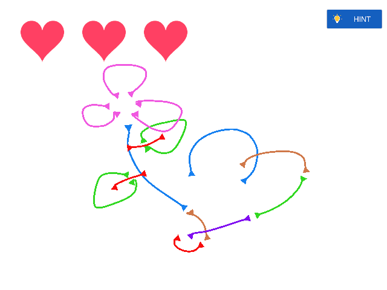
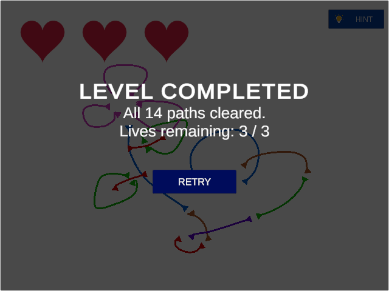
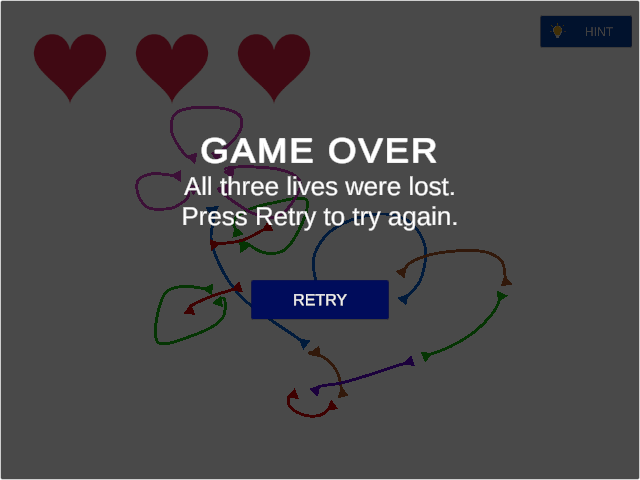

# Arrow Puzzle

A Unity-based puzzle game where players move arrowheads along curved paths, avoid collisions, and clear every line to complete the level.

## 🎮 Gameplay

- Move arrowheads along their respective curved paths.
- Successfully reach the opposite arrowhead to remove a line.
- Multiple lines can be moved simultaneously.
- Avoid collisions between arrowheads.
- Start with **3 lives**. Each collision costs one life.
- Use the Hint system to identify a randomly selected legal move.
- Clear all lines to win the level.

## ✨ Features

- Smooth curved paths using Catmull–Rom splines.
- Arrowhead movement and collision detection.
- Life management system.
- Win and lose conditions with retry functionality.
- Hint system that highlights a valid move.
- Data-driven level configuration using JSON.
- Separate gameplay logic and level data.
- Editor-side validation and gameplay verification tools.

## 🕹️ Controls

| Input | Action |
|---|---|
| Mouse click and drag | Move an arrowhead along its path |
| Hint button | Highlight a randomly selected legal move |
| Retry button | Restart the level |

## 🛠️ Built With

- **Engine:** Unity 6.3 LTS
- **Unity Version:** `6000.3.9f1`
- **Language:** C#
- **Input:** Unity Input System
- **UI:** TextMesh Pro
- **Path System:** Catmull–Rom spline interpolation
- **Level Configuration:** JSON

## 📁 Project Structure

```text
ArrowPuzzle/
├── Assets/
│   ├── Editor/          # Editor validation tools
│   ├── LevelData/       # JSON level configuration
│   ├── Scenes/          # Game scene
│   ├── Scripts/
│   │   ├── Arrows/      # Arrow movement and path logic
│   │   ├── Core/        # Game state and lives
│   │   ├── Gameplay/    # Hint system
│   │   ├── Levels/      # Level loading and JSON parsing
│   │   └── UI/          # Game UI
│   └── Sprites/         # Game sprites and level artwork
├── Packages/
└── ProjectSettings/
```

## 🚀 Getting Started

### Requirements

- Unity Hub
- Unity `6000.3.9f1`

### Open in Unity

1. Clone this repository:

   ```bash
   git clone https://github.com/Sanju013/ArrowPuzzle.git
   ```

2. Open Unity Hub.
3. Select **Add Project from Disk**.
4. Select the cloned `ArrowPuzzle` folder.
5. Open the project using Unity `6000.3.9f1`.
6. Open `Assets/Scenes/GameScene.unity`.
7. Press **Play** to start the game.

## 🏗️ Windows Build

A playable Windows standalone build is provided separately.

Extract the build ZIP and run `ArrowPuzzle.exe`.

Keep all files and folders from the extracted build directory together. The executable depends on the accompanying Unity data and runtime files.

## 📸 Screenshots

### Gameplay HUD


### Win Screen


### Lose Screen


## 📌 Project Notes

- The project currently contains one playable level.
- Level configuration is stored separately from gameplay logic.
- The level loader is designed to support additional level data without requiring changes to the core gameplay systems.
- Editor validation utilities are included under `Assets/Editor/`.

## 👨‍💻 Author

Developed as a Unity game development assignment.

**Repository:** [ArrowPuzzle](https://github.com/Sanju013/ArrowPuzzle)
